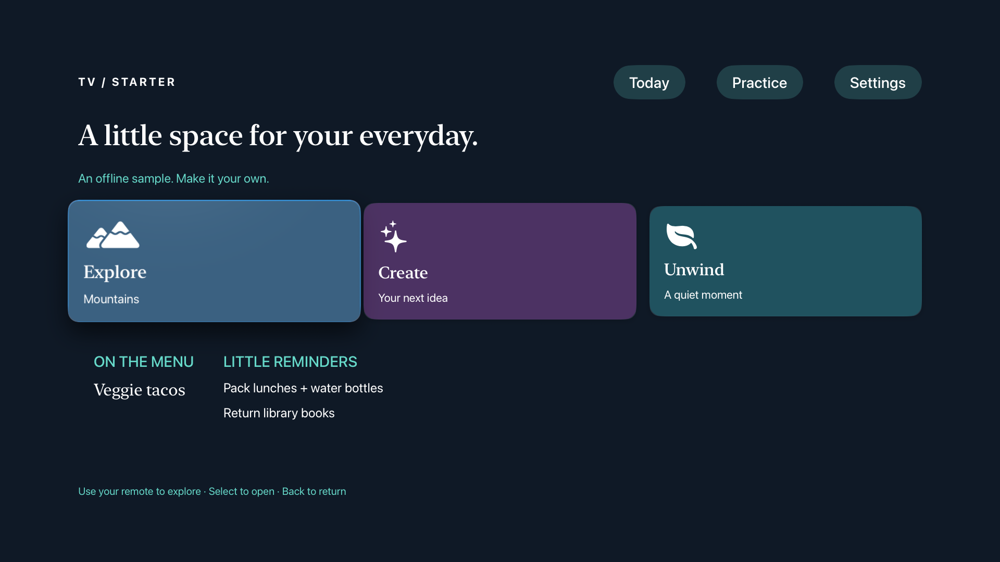
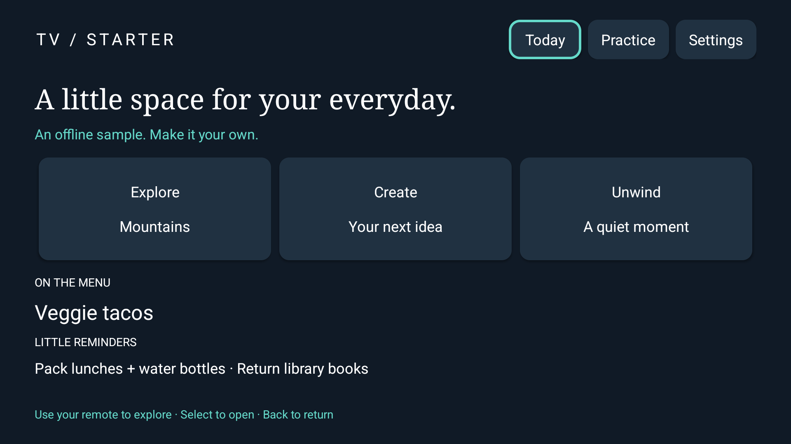

# TV App Starter

**Your TV deserves an app you made.**

A reading list on the big screen. A little dashboard for your day. Something wonderfully specific that nobody’s put in an app store yet.

This started with building custom TV apps using Codex. That was fun enough to turn the starting point into something you can use too. Bring an idea, pick Apple TV or Android TV, and build with Codex or Claude Code.

You get two native sample apps, a reusable building skill, and a small script that gives your project its own folder and app ID. The samples run offline, so you can start playing without setting up accounts or a backend.

[Build with your agent](#bring-your-idea) · [Run the sample](#take-it-for-a-spin) · [Make your first change](#make-it-yours)

## Here’s your starting point

### Apple TV



Those three cards? They’re yours to replace. The Apple TV sample uses SwiftUI, with remote navigation and a detail screen behind each card.

### Android TV / Google TV



The Android sample has the same little journey, built with native Android controls. Follow the focus outline, select a card, and use Back to return. Compatible TCL Android TV and Google TV models can run it too.

Both samples include practice check-offs and a light/dark switch. Appearance survives a relaunch; practice check-offs stay in memory for now.

## Bring your idea

First, grab the starter. You’ll need Git and Python 3; your chosen platform’s build tools come next.

```sh
git clone https://github.com/dsampath/tv-app-starter.git
cd tv-app-starter
```

**Using Codex?** Open this folder in Codex. The bundled skill is available as `$build-tv-app`. Try this:

```text
$build-tv-app Build an Apple TV reading-list app in a new sibling folder
called reading-room, using org.example.readingroom as the bundle ID.
Start with three fictional books, big remote-friendly cards, and a detail
screen for each book. Keep it offline. Build it for the simulator and
explain how I can try it.
```

**Using Claude Code?** From the starter folder, load the local plugin:

```sh
claude --plugin-dir .
```

Then use `/tv-app-starter:build-tv-app` followed by the same request. Swap “Apple TV” for “Android TV” if that’s your screen of choice.

Give your agent an app idea, a platform, and a fresh destination folder. It has the sample sources and build instructions to work from. You’ll still need Xcode for Apple TV, or the Android SDK and JDK 17 for Android TV. The guides below walk through those tools.

Curious about the packaging? See [how the skill and plugin fit together](docs/AGENT_WORKFLOW.md).

## Take it for a spin

Want to explore the sample before asking an agent to change it? Pick your route:

- **Apple TV:** on a Mac with Xcode and the tvOS SDK installed, open `FamilyTV.xcodeproj`, choose the `FamilyTV` scheme and a tvOS simulator, then Run. [Apple TV setup →](docs/APPLE_TV.md)
- **Android TV:** download `TVStarter.apk` from the [preview release](https://github.com/dsampath/tv-app-starter/releases/tag/v0.1.0), then install it on your own TV or emulator using `adb`. [Android TV setup →](docs/ANDROID_TV.md)

When the dashboard appears, open a card and come back. Try Practice, then switch the appearance in Settings. Now you’ve got something to build on.

## Make it yours

Let’s turn those three cards into a reading list.

If you’re working by hand, create your own copy from the starter folder:

```sh
python3 skills/build-tv-app/scripts/new_app.py ../reading-room \
  --bundle-id org.example.readingroom
cd ../reading-room
```

Choose a folder that doesn’t exist yet. The generator leaves existing projects alone and gives your copy its own app ID.

For **Apple TV**, edit the three `tile(...)` calls in `FamilyTV/FamilyTVApp.swift`. Replace their titles and subtitles with fictional book names and authors. For **Android TV**, edit the `titles` and `details` arrays in `AndroidTV/src/org/example/readingroom/MainActivity.java`.

Build and run again using your platform guide. You should see your books where Explore, Create, and Unwind used to be. Select one: the sample detail screen is your next place to add a synopsis, a reading note, or a “finished” button.

That’s the loop: change a little, try it with the remote, then keep going. If you’re working with an agent, ask it to make that same first change and check the result with you.

## A few things to know

This is an early starter for regular TV apps. Installing on a real Apple TV needs your own signing setup; Android TV needs developer debugging enabled. Store publishing and system screensavers are separate projects. Native builds and the shared Swift tests pass. Android remote flows were checked in an emulator; the Apple TV dashboard was checked in a simulator. Full Apple TV remote interaction and real-TV checks remain for review. See [what’s been tested](docs/VALIDATION.md) for the details.

The samples use generic content and include no personal deployment configuration. Keep your own keys, device settings, and photos local as you customize. [Privacy notes →](docs/PRIVACY.md)

## Got a good idea?

A tiny kitchen timer? A dashboard for game night? A reading room with absolutely no notifications?

Try it. If you find a rough edge or a useful improvement, open an issue or send a pull request. [The contribution guide](CONTRIBUTING.md) will help you get started.

Code, sample icons, and screenshots are [MIT licensed](LICENSE). Make something you’ll enjoy seeing on your TV.
